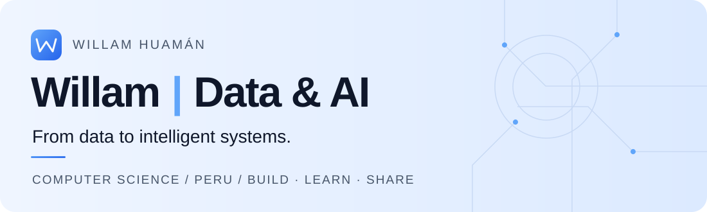
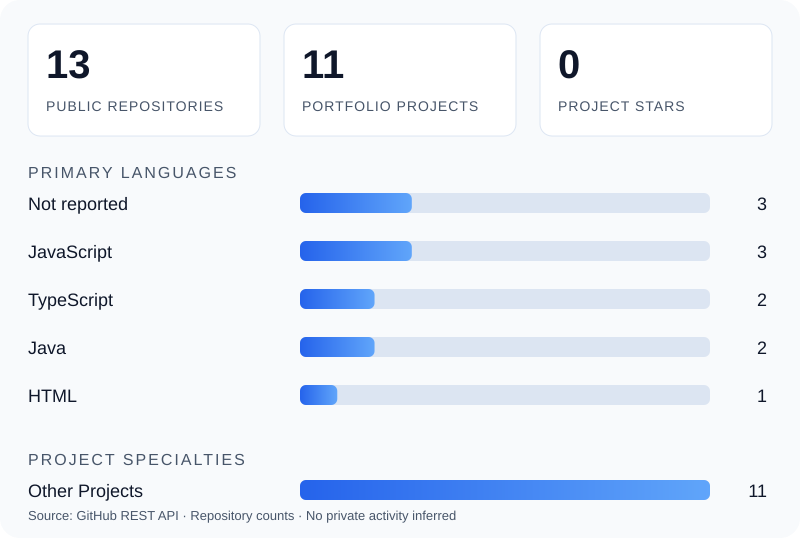

<picture>
  <source media="(prefers-color-scheme: dark)" srcset="assets/banners/header-dark.svg" />
  <source media="(prefers-color-scheme: light)" srcset="assets/banners/header-light.svg" />
  
</picture>

  
  
  
  
  
  
  
  

## 01 / About me

I'm **Willam Huamán**, based in Peru, with an academic background in **Computer Science**. My goal is to specialize in **AI Engineering**: building useful intelligent applications on a foundation of sound data, software engineering and evaluation.

  <picture>
    <source media="(prefers-color-scheme: dark)" srcset="assets/ascii/portrait-dark.svg" />
    <source media="(prefers-color-scheme: light)" srcset="assets/ascii/portrait-light.svg" />
    
  </picture> 
  One photograph. Thousands of characters. <a href="assets/ascii/portrait.txt">Real ASCII</a>, generated with Python.

My interests span analytics and business intelligence, data science, machine learning, deep learning, data engineering and cloud computing. My learning direction centers on **LLMs, retrieval-augmented generation, AI agents, MLOps and LLMOps**.

I also want to make technical learning accessible through **Willam | Data & AI**, sharing what I learn about data and artificial intelligence. I welcome conversations about early-career opportunities, practical projects and technology education.

 Understand the data &nbsp; → &nbsp;  Build intelligent systems &nbsp; → &nbsp;  Learn to ship reliably

## 02 / Project portfolio

[Explore all repositories](https://github.com/willamhs?tab=repositories) · [How projects are classified](docs/automation.md#classify-a-project)

<!-- PROJECTS:START -->

Public, original, active repositories. Grouped by GitHub topics; each project appears once.

<h3> Other Projects · 11</h3>

<h4><a href="https://github.com/willamhs/flowers-amarillas">flowers-amarillas</a></h4>

<em>No repository description provided.</em>

 JavaScript &nbsp; · &nbsp; 0 stars &nbsp; · &nbsp; Updated 2026-09-21 &nbsp; · &nbsp; <a href="https://flowers-amarillas.vercel.app">Live demo ↗</a> 
<strong>Technologies:</strong> JavaScript <strong>Topics:</strong> Not set

<h4><a href="https://github.com/willamhs/FLORES-AMARILLAS">FLORES-AMARILLAS</a></h4>

<em>No repository description provided.</em>

 JavaScript &nbsp; · &nbsp; 0 stars &nbsp; · &nbsp; Updated 2026-09-21 &nbsp; · &nbsp; <a href="https://flores-amarillas-amber.vercel.app">Live demo ↗</a> 
<strong>Technologies:</strong> JavaScript <strong>Topics:</strong> Not set

<h4><a href="https://github.com/willamhs/nexsia-legal">nexsia-legal</a></h4>

<em>No repository description provided.</em>

 HTML &nbsp; · &nbsp; 0 stars &nbsp; · &nbsp; Updated 2026-06-25 
<strong>Technologies:</strong> HTML <strong>Topics:</strong> Not set

<h4><a href="https://github.com/willamhs/WillamDevCS">WillamDevCS</a></h4>

Config files for my GitHub profile.

Language not reported &nbsp; · &nbsp; 0 stars &nbsp; · &nbsp; Updated 2026-01-16 &nbsp; · &nbsp; <a href="https://github.com/willamhs">Live demo ↗</a> 
<strong>Technologies:</strong> Not identified in public metadata <strong>Topics:</strong> <code>config</code> <code>github-config</code>

Explore 7 more projects

<h4><a href="https://github.com/willamhs/analisissentimientos">analisissentimientos</a></h4>

<em>No repository description provided.</em>

Language not reported &nbsp; · &nbsp; 0 stars &nbsp; · &nbsp; Updated 2025-12-05 
<strong>Technologies:</strong> Not identified in public metadata <strong>Topics:</strong> Not set

<h4><a href="https://github.com/willamhs/Portafolio">Portafolio</a></h4>

<em>No repository description provided.</em>

 JavaScript &nbsp; · &nbsp; 0 stars &nbsp; · &nbsp; Updated 2025-07-17 
<strong>Technologies:</strong> JavaScript <strong>Topics:</strong> Not set

<h4><a href="https://github.com/willamhs/crypto-recommender">crypto-recommender</a></h4>

<em>No repository description provided.</em>

 TypeScript &nbsp; · &nbsp; 0 stars &nbsp; · &nbsp; Updated 2025-07-10 
<strong>Technologies:</strong> TypeScript <strong>Topics:</strong> Not set

<h4><a href="https://github.com/willamhs/Holme-frontend">Holme-frontend</a></h4>

<em>No repository description provided.</em>

 TypeScript &nbsp; · &nbsp; 0 stars &nbsp; · &nbsp; Updated 2024-11-21 
<strong>Technologies:</strong> TypeScript <strong>Topics:</strong> Not set

<h4><a href="https://github.com/willamhs/HoldMe-APIRESTFULL">HoldMe-APIRESTFULL</a></h4>

<em>No repository description provided.</em>

 Java &nbsp; · &nbsp; 0 stars &nbsp; · &nbsp; Updated 2024-11-19 
<strong>Technologies:</strong> Java <strong>Topics:</strong> Not set

<h4><a href="https://github.com/willamhs/AnalsisSentimientos">AnalsisSentimientos</a></h4>

<em>No repository description provided.</em>

Language not reported &nbsp; · &nbsp; 0 stars &nbsp; · &nbsp; Updated 2024-11-18 
<strong>Technologies:</strong> Not identified in public metadata <strong>Topics:</strong> Not set

<h4><a href="https://github.com/willamhs/reservation_system_api">reservation_system_api</a></h4>

<em>No repository description provided.</em>

 Java &nbsp; · &nbsp; 0 stars &nbsp; · &nbsp; Updated 2024-08-21 
<strong>Technologies:</strong> Java <strong>Topics:</strong> Not set

Repository descriptions and topics are shown as published by their owner. Technologies come from the primary language and recognized topics; they do not represent a complete dependency audit.

<!-- PROJECTS:END -->

## 03 / Public activity

<!-- STATS:START -->

<picture>
  <source media="(max-width: 600px) and (prefers-color-scheme: dark)" srcset="assets/stats/activity-dark-mobile.svg" />
  <source media="(max-width: 600px)" srcset="assets/stats/activity-light-mobile.svg" />
  <source media="(prefers-color-scheme: dark)" srcset="assets/stats/activity-dark.svg" />
  <source media="(prefers-color-scheme: light)" srcset="assets/stats/activity-light.svg" />
  
</picture>

Read the numbers and methodology

**13 public repositories** owned by this account, including forks, archived repositories and this profile. **11 portfolio projects** and **0 project stars** after excluding forks, archived repositories, this profile and configured exclusions.

| Primary language | Projects |
| :--- | ---: |
| Not reported | 3 |
| JavaScript | 3 |
| TypeScript | 2 |
| Java | 2 |
| HTML | 1 |

| Specialty | Projects |
| :--- | ---: |
| Other Projects | 11 |

Languages count the primary language of each eligible repository, rather than code volume or proficiency. Each project belongs to one specialty. An empty language is shown as “Not reported”. All charts share the [same API snapshot](assets/projects/snapshot.json). The snapshot changes only when public metadata changes; its Git history records refreshes. Contribution totals are intentionally omitted: this REST snapshot cannot reliably measure them. [View GitHub’s native contribution graph](https://github.com/willamhs#year-list-container).

<!-- STATS:END -->

## 04 / Technology & learning

**Built in this repository:** [Python automation](scripts/update_projects.py), [image processing](scripts/generate_ascii.py), [API integration](scripts/update_projects.py), [automated checks](tests/) and [GitHub Actions](.github/workflows/update-profile.yml).

**Explore the code:** each project above links directly to its source and reports the primary language and technologies identified by its public metadata.

<strong>Explore my technology roadmap across eight disciplines</strong>

<!-- STACK:START -->

These technologies form my **development roadmap**. A logo is not a claim of proficiency. Project links and repository metadata provide the evidence for tools I have used.

#### Programming & Data Analysis

 Python &nbsp; · &nbsp;
SQL &nbsp; · &nbsp;
 R &nbsp; · &nbsp;
 Pandas &nbsp; · &nbsp;
 NumPy &nbsp; · &nbsp;
 Jupyter &nbsp; · &nbsp;
 Matplotlib &nbsp; · &nbsp;
 Seaborn &nbsp; · &nbsp;
 Plotly

#### Business Intelligence

 Power BI &nbsp; · &nbsp;
 Tableau &nbsp; · &nbsp;
 Excel &nbsp; · &nbsp;
 Looker Studio

#### Databases

 PostgreSQL &nbsp; · &nbsp;
 MySQL &nbsp; · &nbsp;
 SQL Server &nbsp; · &nbsp;
 MongoDB &nbsp; · &nbsp;
 Redis

#### Machine Learning & Deep Learning

 Scikit-learn &nbsp; · &nbsp;
 TensorFlow &nbsp; · &nbsp;
 PyTorch &nbsp; · &nbsp;
 Keras &nbsp; · &nbsp;
 XGBoost &nbsp; · &nbsp;
 LightGBM &nbsp; · &nbsp;
 CatBoost

#### AI Engineering & Generative AI

 OpenAI &nbsp; · &nbsp;
 Gemini &nbsp; · &nbsp;
 Hugging Face &nbsp; · &nbsp;
 LangChain &nbsp; · &nbsp;
 LangGraph &nbsp; · &nbsp;
 Ollama &nbsp; · &nbsp;
 FastAPI &nbsp; · &nbsp;
LLMs &nbsp; · &nbsp;
RAG &nbsp; · &nbsp;
AI Agents &nbsp; · &nbsp;
Vector Databases

#### Data Engineering

 Apache Spark &nbsp; · &nbsp;
 Apache Kafka &nbsp; · &nbsp;
 Apache Airflow &nbsp; · &nbsp;
 Databricks &nbsp; · &nbsp;
 dbt &nbsp; · &nbsp;
ETL &nbsp; · &nbsp;
ELT &nbsp; · &nbsp;
Data Warehousing

#### Cloud Computing

 Google Cloud Platform (GCP) &nbsp; · &nbsp;
 BigQuery &nbsp; · &nbsp;
 Vertex AI &nbsp; · &nbsp;
 Amazon Web Services (AWS) &nbsp; · &nbsp;
 Microsoft Azure

#### DevOps & MLOps

 Git &nbsp; · &nbsp;
 GitHub &nbsp; · &nbsp;
 GitHub Actions &nbsp; · &nbsp;
 Docker &nbsp; · &nbsp;
 Kubernetes &nbsp; · &nbsp;
 MLflow &nbsp; · &nbsp;
 Terraform

Official catalog icons retain their source colors. SQL and architectural concepts use text labels. Vertex AI uses its parent Google Cloud mark; Looker Studio uses the Looker mark. <a href="docs/icon-sources.md">Icon sources and licenses</a>.

<!-- STACK:END -->

## 05 / Let's build something useful

Interested in data, AI applications or technology education? Let's connect.

**[LinkedIn](https://www.linkedin.com/in/willam-huaman-saavedra/)** &nbsp; · &nbsp; **[Portfolio](https://portafolio-willam.netlify.app/)** &nbsp; · &nbsp; **[U20211E088@upc.edu.pe](mailto:U20211E088@upc.edu.pe)**

Built with Python, local SVG assets and GitHub Actions. Projects and statistics refresh daily from public GitHub metadata. [Automation & methodology](docs/automation.md) · [Design & portrait](docs/design.md).
